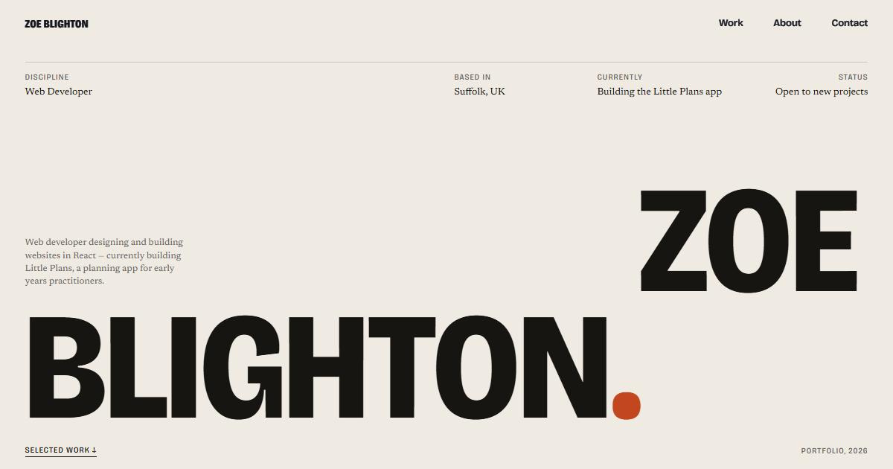

# Zoe Blighton: portfolio

My portfolio, built as a typography-led editorial site in React.

**[zoeblighton.com →](https://zoeblighton.com)**



## Design

- **Type as the main visual.** Headlines are fitted edge to edge by a small hook (`useFit`) that measures each line and scales it to the container. Bricolage Grotesque handles the display type and Newsreader the body and italic asides.
- **Art-directed projects.** Each project picks one of four layouts (feature, split, type-led or a staggered pair), so the work section reads like a magazine spread rather than a card grid. The type-led layout previews its screenshot under the cursor.
- **Quiet motion.** Lines and images reveal on scroll (`useReveal`, IntersectionObserver), and the header hides as you scroll down. All of it switches off under `prefers-reduced-motion`.

## Built with

React 19 (Create React App), plain CSS, EmailJS for the contact form. Hosted on Netlify.

## Editing content

All copy, projects, links and the CV path live in [`src/content.js`](src/content.js). Layout code never needs touching to update the site:

- **Add a project**: add an entry to `projects` and import its screenshot from `src/`. Choose a `layout`: `"feature"`, `"split"`, `"type"` or `"pair"` (consecutive pairs sit side by side).
- **Replace the CV**: put the PDF in `public/resume/` and update `resumeUrl`.

## Run locally

```bash
npm install
npm start        # http://localhost:3000
npm run build    # production build in build/
```

## Structure

```
src/
  content.js    all editable content
  components/   Header, Hero, Work, Project, About, Contact, ResumeModal, Cursor…
  hooks/        useFit (fit headlines to width), useReveal (scroll reveals)
public/         CV, share image, sitemap
```
